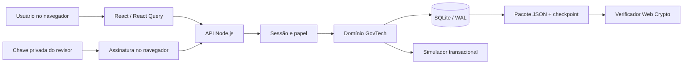
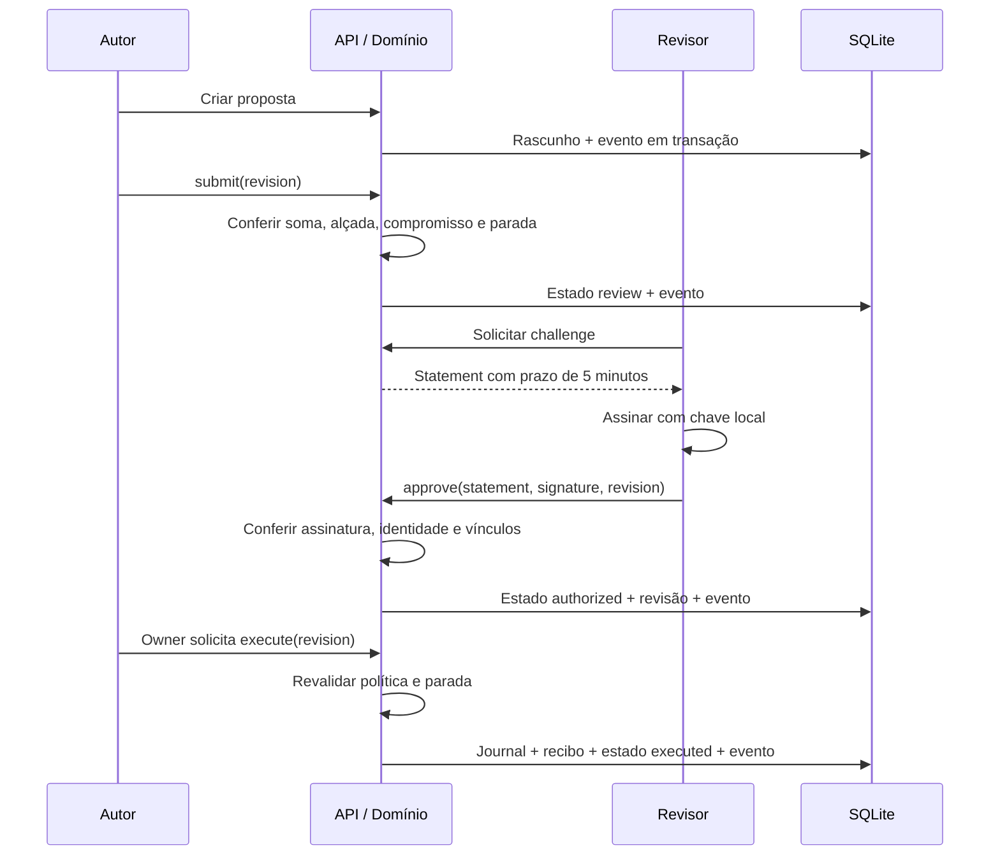

# Arquitetura e fronteiras

## Visão do sistema

O GovTech é uma aplicação Next.js com interface React, API HTTP em Node.js e armazenamento SQLite local. O domínio é implementado em módulos JavaScript sem dependência do frontend. O verificador de pacotes é um módulo portátil que usa Web Crypto; a página offline contém a mesma lógica e uma interface independente.

Os sistemas públicos não aparecem como destinos executáveis nesse fluxo. As referências a SIAFE, e-GP e gov.br identificam cenários de simulação.

## Mapa do código

| Caminho | Responsabilidade |
| --- | --- |
| `app/layout.tsx` | Idioma, metadados, providers, shell de autenticação e CSS |
| `app/page.tsx` | Entrada do aplicativo |
| `app/login/page.tsx` | Formulário de login, com erro e estado de processamento |
| `app/govtech/page.tsx` | Alias de compatibilidade que redireciona para `/` |
| `app/api/[...path]/route.ts` | Adaptador Next para GET/POST; runtime Node |
| `components/auth-shell.tsx` | Consulta da sessão, identificação do papel e logout |
| `components/govtech-app.tsx` | Navegação dos nove módulos, seleção de processos e operações |
| `components/govtech-forms.tsx` | Cadastro, edição de alçadas e assinatura local |
| `components/govtech-operations.tsx` | Fila, cockpit, plano, confirmações e dossiê |
| `lib/http.mjs` | Autenticação da requisição, limite JSON, origem e roteamento |
| `lib/auth.mjs` | Contas de bootstrap, scrypt, sessões e bloqueio de tentativas |
| `lib/govtech.mjs` | Regras de negócio e persistência dos registros GovTech |
| `lib/store.mjs` | Conexão SQLite, pragmas e transações síncronas |
| `lib/crypto.mjs` | Verificação Ed25519 nativa do Node |
| `lib/observability.mjs` | Logs HTTP e métricas de processo |
| `public/govtech/verify.mjs` | Verificador independente de pacotes |
| `public/govtech/offline.html` | Página autossuficiente para verificação offline |

## Fronteiras de confiança

1. **Navegador → API:** toda entrada é não confiável. O frontend não decide autorizações. O servidor obtém o ator da sessão e ignora identidades escolhidas pelo cliente na criação de processos.
2. **Sessão → domínio:** papéis limitam operações. `author` cria e encaminha suas propostas; `reviewer` pode revisar propostas de outra pessoa; `owner` administra políticas e executa o simulador. O owner também pode propor, mas não se autoaprovar.
3. **Proposta → efeito:** a transição exige política, soma válida, revisão assinada e política ainda correspondente. Confirmações visuais explicam a operação, mas não substituem os controles do servidor.
4. **Persistência → auditor:** o pacote é transporte não confiável. O verificador exige um checkpoint fornecido pelo auditor e o usa para conferir a cadeia e o snapshot.
5. **Host → aplicação:** arquivos de contas, chaves, código, relógio e banco são administrados pelo operador. O aplicativo não protege contra um administrador malicioso do host.

## Caminho principal

O último ator do diagrama é uma conta de governança; não precisa ser o autor. A autorização não oferece uma API pública de execução remota nem entrega credenciais de sistemas estatais ao navegador.

## Persistência e custos

SQLite opera com WAL, `synchronous=FULL`, chaves estrangeiras e aquisição `BEGIN IMMEDIATE`. Os callbacks de transação precisam ser síncronos. A repetição por contenção se aplica à aquisição da transação, não a um callback que possa produzir efeitos.

O estado da instalação verifica toda a cadeia e consulta coleções em memória. Não há paginação de processos ou checkpoint incremental de integridade. O projeto privilegia um fluxo local inspecionável; não oferece metas de throughput ou latência de produção. A lista de eventos da interface limita a exibição aos 100 mais recentes, mas a exportação contém o prefixo completo.

## Independência e limites

O app não importa os crates Rust, o WASM do monorepo ou a base PostgreSQL do Intra. O predicado aritmético local e a cadeia SHA-256 possuem nomes de domínio próprios. Os seis estágios mostrados na interface são uma organização conceitual; não demonstram que o app está executando o ContainmentGate Rust ou um kernel em enclave.

Não há motor de interpretação de leis, LLM conectado, prova de raciocínio, conectores oficiais, identidade governamental ou certificação de conformidade. A [migração](MIGRATION.md) explica as adaptações, e o [roadmap](ROADMAP.md) organiza as qualificações necessárias.
