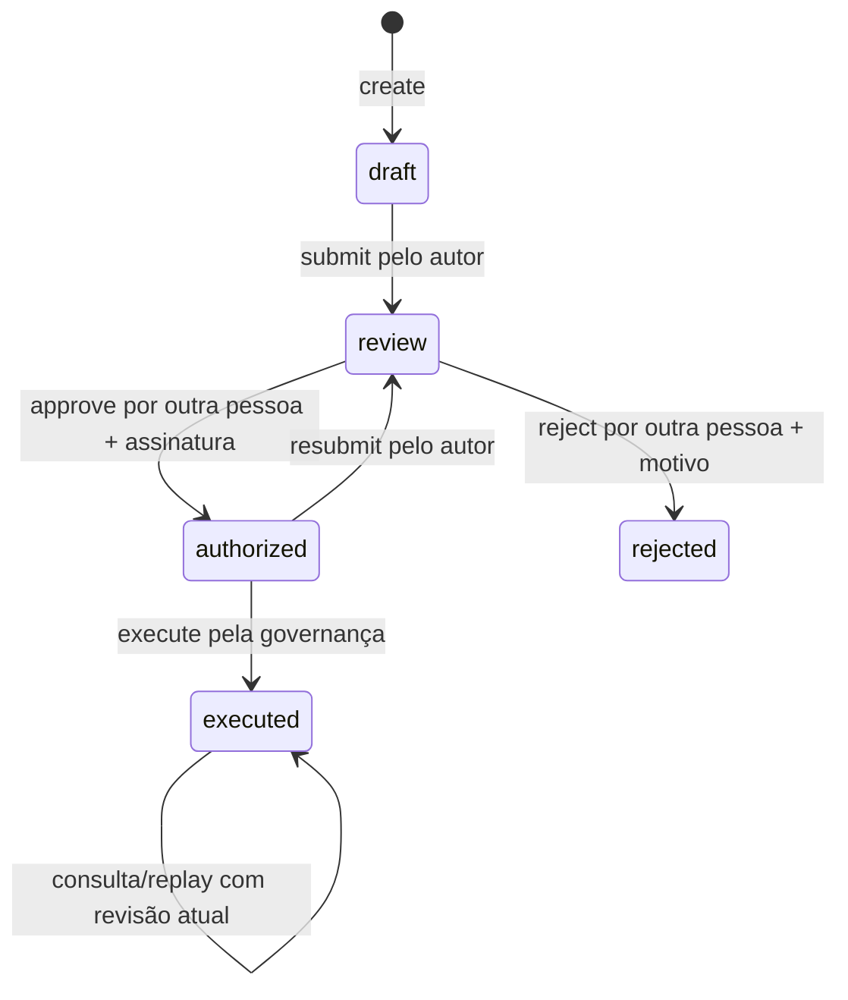

# Domínio, estados e permissões

## Entidades

**Órgão:** identificador de escopo de política. Os valores iniciais são `administracao`, `fazenda` e `inovacao`. Os nomes são referências demonstrativas, não cadastros oficiais nem prova de parceria.

**Modalidade:** `despesa`, `licitacao` ou `atendimento`. A escolha define o rótulo do destino simulado. Licitação e atendimento não executam análise automática de documentos ou conversa com um modelo; usam propostas estruturadas.

**Processo:** UUID gerado pelo host, campos declarados, itens, autor autenticado, revisão otimista, estado, digest e evidências de revisão/execução. Os dados da proposta são imutáveis após criação nesta versão. Não há edição, exclusão ou importação de processos pela API.

**Política:** órgão, limite em centavos, limiar de atenção e máximo de itens. A configuração possui revisão global e sinal de emergência. O limiar é informativo; toda aprovação exige revisão humana.

**Revisão:** statement assinado, assinatura Ed25519, chave pública do revisor, identidade local e data. A aprovação e a rejeição têm controles diferentes: aprovar exige assinatura; rejeitar exige sessão autorizada, independência e motivo.

**Recibo:** evidência de execução sintética com OperationId, processo, compromisso da proposta, política, destino, total, data e `externalEffect:false`.

**Plano de piloto:** responsável, data-alvo, observações, revisão e cinco controles. Estados dos controles: `pending`, `progress`, `documented`. Referências são declarações e não são consultadas ou certificadas pelo servidor.

## Máquina de estados

Não há retorno de `rejected` para rascunho nem alteração de conteúdo. Para reapresentar uma proposta rejeitada, crie um novo processo, preservando a referência ao histórico na justificativa.

## Matriz de autorização

| Ação | Author | Reviewer | Owner |
| --- | --- | --- | --- |
| Ver processos | Somente os próprios | Todos, inclusive rascunhos | Todos |
| Criar processo | Sim | Não | Sim |
| Enviar rascunho | Somente próprio | Não | Somente próprio |
| Aprovar | Não | Outra pessoa como proponente | Outra pessoa como proponente |
| Rejeitar | Não | Outra pessoa como proponente | Outra pessoa como proponente |
| Solicitar nova revisão | Próprio autorizado | Não | Próprio autorizado |
| Executar simulador | Não | Não | Sim |
| Exportar cadeia | Não | Sim | Sim |
| Ver plano de piloto | Não | Sim | Sim |
| Editar plano/políticas/emergência | Não | Não | Sim |
| Ver métricas HTTP | Não | Não | Sim; ou token de métricas dedicado |

Papéis são atribuídos pelo bootstrap local. A interface não permite autocadastro, troca de papel ou emissão de novos poderes. Uma alteração manual de conta é operação administrativa fora do fluxo de usuário.

## Validação da proposta

- Título: string aparada, de 4 a 180 caracteres.
- Referência administrativa: de 3 a 100 caracteres. Não há unicidade por referência.
- Justificativa: de 10 a 12.000 caracteres.
- Fonte: exatamente 64 caracteres hexadecimais minúsculos, declarando SHA-256.
- Itens: de 1 a 256, com descrição de 1 a 120 caracteres.
- Valor de item: inteiro seguro, entre 0 e 100.000.000 centavos.
- Soma: inteiro seguro, não superior à alçada vigente na submissão/aprovação/execução.
- Órgão e modalidade: enumerações aceitas pelo servidor.

O arquivo-fonte é opcional no navegador: selecionar um arquivo de até 16 MiB calcula seu hash localmente; o usuário também pode informar o digest diretamente. O servidor não recebe os bytes da fonte e não os autentica.

## Política e emergência

O limite inicial por órgão é 10.000.000 centavos, e o limiar inicial é 500.000 centavos. A política admite limite de 0 a 10.000.000.000 centavos, com limiar não superior ao limite. O máximo de 256 itens não é editável pela API.

Qualquer atualização da configuração incrementa sua revisão global, inclusive parada e retomada. Por conservadorismo, isso invalida o despacho de autorizações anteriores, mesmo que a alteração tenha ocorrido em outro órgão. O autor pode solicitar nova revisão de um processo autorizado; não pode obter aprovação por conta própria.

A parada é persistida e consultada pelo domínio antes de novas autorizações e efeitos. Seu alcance é esta instalação. Não há protocolo de interrupção distribuída nem cancelamento de efeitos remotos em curso. Um processo já executado pode devolver seu recibo sem novo efeito durante a parada.

## Invariantes verificáveis

1. Identidade do proponente vem da sessão.
2. Alterações de estado exigem a revisão atual do processo; configuração e plano têm suas próprias revisões.
3. Proponente e aprovador são identidades locais diferentes.
4. A aprovação vincula caso, conteúdo, revisão, política e revisor em um statement Ed25519.
5. Política e soma são verificadas antes do efeito, e a revisão da configuração precisa coincidir com a aprovada.
6. Journal único por processo e OperationId; efeito sintético e evidência são atômicos localmente.
7. Evento e snapshot da operação são vinculados por hash.

Essas invariantes não provam que os dados são verdadeiros, que a política corresponde à lei ou que um principal externo tem poderes jurídicos.
